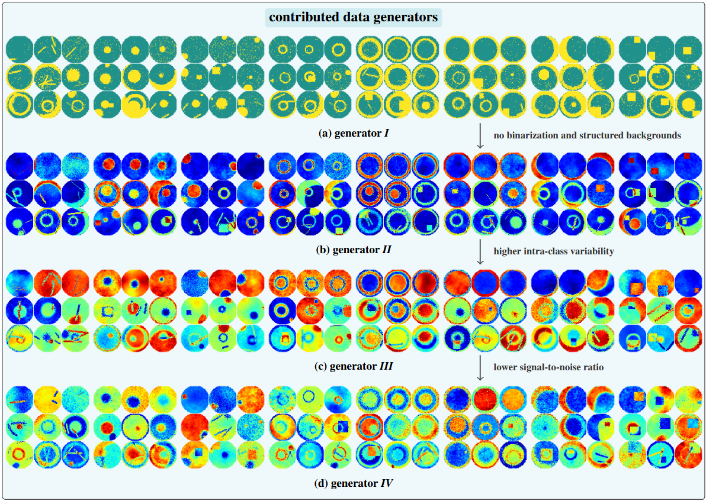

<h1 align="center">
  ♾️🌐 EndlessWaferMaps ♾️🌐
</h1>

<p align="center">
labelled wafer test streams with controllable data drifts and signal-to-noise ratio
</p>

<p align="center">
  <a href="https://www.repostatus.org/#active"></a>
  <a href="https://dataverse.harvard.edu/dataset.xhtml?persistentId=doi%3A10.7910%2FDVN%2FLDQQIW"></a>
  <a href="https://www.python.org/"></a>
  <a href="https://github.com/astral-sh/ruff"></a>
  <a href="LICENSE"></a>
</p>

<p align="center">
  <a href="#-what-is-this">ℹ️ Overview</a> •
  <a href="#-datasets-and-streams">📄 Data</a> •
  <a href="#-installation">📦 Installation</a> •
  <a href="#-experiments">⚗️ Experiments</a> •
  <a href="#-notebooks-and-dashboards">📓 Notebooks</a> •
  <a href="#-citation">📝 Citation</a>
</p>

<p align="center">
  
</p>

---

## ℹ️ What is this?

This is the official repository accompanying our **WACV 2027 (Evaluations & Datasets Track)** paper, *"Endless Wafer Maps: Labeled Wafer Test Streams with Controllable Data Drifts and Signal-to-noise Ratio"*, and its [Harvard Dataverse dataset publication](https://dataverse.harvard.edu/dataset.xhtml?persistentId=doi%3A10.7910%2FDVN%2FLDQQIW).

EndlessWaferMaps is a synthetic wafer test benchmark consisting of multiple labelled streams and evaluation datasets sampled from four progressively more challenging data generators. Each sample includes a wafer map, multi-label annotations, semantic segmentation masks, separated background and pattern signals, and generative parameters to support controlled analyses.

This repository contains the configurable data generators, dataset and stream presets, and the experiment and analysis code used for the publication.

The benchmark addresses the limited availability of wafer test data: manufacturers rarely publish production measurements to avoid revealing intellectual property, while public datasets such as WM811K[^1] and MixedWM38[^2] reflect simplified, static settings. Wafer test data is not stationary: products, materials, tests, and equipment conditions change over time, requiring regular model performance monitoring and retraining.[^3]

Each wafer map combines two signals: a background signal representing the normal test distribution and a pattern signal representing process deviations. This construction follows the intuition and causal structure of additive noise models.[^4][^5] It gives separate access to normal process variation, process deviations, their location, and the signal-to-noise ratio as a proxy for sample complexity.[^6] The four generators vary in test modality, background complexity, pattern diversity, and signal-to-noise ratio.

Drifting streams are modeled with [StreamGen](https://github.com/Infineon/StreamGen).[^7] Generative functions, transformations, and corruptions are composed into a tree that is traversed from root to leaf, while the generative parameters of each node are scheduled to create covariate and concept drift, shifts in signal-to-noise ratio, and changes in class and cardinality priors.

## 📄 Datasets and Streams

The benchmark contains static training and test datasets as well as exploratory and realistic continual-learning streams. The files described in the paper are available through [Harvard Dataverse](https://dataverse.harvard.edu/dataset.xhtml?persistentId=doi%3A10.7910%2FDVN%2FLDQQIW).

| Files | Description | Cardinality | Class prior | Samples | Seeds | Size [GB] |
| --- | --- | ---: | ---: | ---: | ---: | ---: |
| `{i--iv}.hdf5` | static training datasets | long-tailed | uniform | 100k | 1 | 2.0 |
| `{i--iv}-t.hdf5` | test datasets | uniform | uniform | 10k | 1 | 0.2 |
| `{i--iv}-e-{1--3}.hdf5` | explorative training streams | long-tailed | uniform | 26 × 200 | 3 | 0.1 |
| `{i--iv}-e-{1--3}-t.hdf5` | explorative test streams | long-tailed | uniform | 26 × 400 | 3 | 0.2 |
| `{i--iv}-r-{1--3}.hdf5` | realistic training streams | long-tailed | 3 patterns/task | 52 × 400 | 3 | 0.2 |
| `{i--iv}-r-{1--3}-t.hdf5` | realistic test streams | long-tailed | uniform | 52 × 400 | 3 | 0.4 |

The exploratory setting contains 26 tasks, corresponding to approximately half a year of weekly data, and provides a controlled test bed with clear learning dynamics. The longer 52-task realistic setting contains only three patterns per task, long-tailed class and cardinality priors, and alternating phases of mild and more dramatic drift.

Datasets and streams are stored in HDF5.[^8] Tasks can be read sequentially without loading an entire stream into memory, while observations and generation metadata remain in the same portable file. We created a [PyTorch dataset class](https://github.com/LaurenzBeck/EndlessWaferMaps/blob/main/endlesswm/io/datasets.py), which make it very easy to work with our datasets:

```python
from torch.utils.data import DataLoader
from endlesswm.io.datasets import H5WM

# Static dataset (or full stream indexed across tasks)
# `fields` selects which HDF5 datasets to return (default: ("sample", "multilabel") for multi-label classification;
# available: "sample", "pattern", "background", "multilabel", "masks", "wafer_mask")
dataset = H5WM("path/to/extracted/harvard_dataverse_directory/iii.hdf5", fields=("sample", "multilabel", "masks"))
sample, label, masks = dataset[0]

# Continual-learning stream iterated task by task
stream = H5WM("path/to/extracted/harvard_dataverse_directory/iii-r-1.hdf5")
for task_dataset in stream.tasks:
    loader = DataLoader(task_dataset, batch_size=128, shuffle=True)
    ...
```

## 📦 Installation

EndlessWaferMaps requires Python 3.11 or newer and [Poetry](https://python-poetry.org/) 2.0 or newer.

```bash
git clone <repository-url>
cd EndlessWM
poetry install
```

List the available presets or generate all configured datasets and streams with:

```bash
poetry run python -m endlesswm list-presets
poetry run python -m endlesswm generate --all-presets --skip-existing
```

To reproduce the published benchmark files, generate the `published` preset group:

```bash
poetry run python -m endlesswm generate --preset-group published --skip-existing
```

To generate a single preset, pass the name shown by `list-presets`:

```bash
poetry run python -m endlesswm generate static/iii
```

Use `--dry-run` to inspect resolved generation runs without writing data.

## ⚗️ Experiments

Experiments use [Hydra](https://hydra.cc/) configurations under [`experiments/conf`](experiments/conf). Config groups define the data, model, augmentation, loss, optimizer, scheduler, and continual-learning method. Runs and metrics are written under `experiments/reports`, and the analysis notebooks read these reports to reproduce the publication figures.

For example, the static dataset complexity experiment compares the learning curves of generators I--IV across dataset sizes and random seeds:

```bash
poetry run python experiments/src/experiments/main.py --multirun experiment=static_complexity
```

## 📓 Notebooks and Dashboards

The interactive [Marimo](https://marimo.io/) dashboards under [`notebooks`](notebooks) support inspection of generated datasets, presets, parameter schedules, tree components, and wafer-map patterns. The dataset explorer shows samples, parameter distributions, and signal-to-noise ratios directly from generated HDF5 files.

```bash
poetry run marimo run notebooks/dataset_explorer.py
```

Publication experiment analyses and figure workflows are collected under [`experiments/src/notebooks`](experiments/src/notebooks).

## 📝 Citation

If you use our datasets, or want to cite our framework and/or experiments, use:

```bibtex
@inproceedings{farthofer2027,
  author    = {Farthofer, Laurenz A. and Masana, Marc},
  title     = {{Endless Wafer Maps}: Labeled Wafer Test Streams with Controllable Data Drifts and Signal-to-noise Ratio},
  booktitle = {Proceedings of the IEEE/CVF Winter Conference on Applications of Computer Vision (WACV)},
  year      = {2027},
}
```

If you are interested in our earlier work on multi-label learning, continual learning and wafer test data, check out:

- [StreamGen (JOSS Publication)](https://joss.theoj.org/papers/10.21105/joss.07206)
- [StreamGen (GitHub Repo)](https://github.com/Infineon/StreamGen)
- [Multi-Label Cardinality-Incremental Learning (CVWW 2026 Publication)](https://cmp.felk.cvut.cz/cvww2026/assets/pdfs/CVWW2026-07-final.pdf)
- [Multi-Label Cardinality-Incremental Learning (GitHub Repo)](https://github.com/LaurenzBeck/Cardinality-Incremental-Learning)

## 🙏 Acknowledgement

Made with ❤️ and ☕ by Laurenz Farthofer.

I want to thank Infineon and KAI for letting me work on and publish this project.

Finally, I want to thank my university supervisors Thomas Pock and Marc Masana for their guidance.

---

## 📄 References

[^1]: M.-J. Wu, J.-S. R. Jang, and J.-L. Chen, “Wafer Map Failure Pattern Recognition and Similarity Ranking for Large-Scale Data Sets,” *IEEE Transactions on Semiconductor Manufacturing*, vol. 28, no. 1, pp. 1–12, 2015. doi: [10.1109/TSM.2014.2364237](https://doi.org/10.1109/TSM.2014.2364237).
[^2]: J. Wang, C. Xu, Z. Yang, J. Zhang, and X. Li, “Deformable Convolutional Networks for Efficient Mixed-Type Wafer Defect Pattern Recognition,” *IEEE Transactions on Semiconductor Manufacturing*, vol. 33, no. 4, pp. 587–596, 2020. doi: [10.1109/TSM.2020.3020985](https://doi.org/10.1109/TSM.2020.3020985).
[^3]: Z. Zhao, J. Wang, Q. Tao, A. Li, and Y. Chen, “An Unknown Wafer Surface Defect Detection Approach Based on Incremental Learning for Reliability Analysis,” *Reliability Engineering & System Safety*, vol. 244, p. 109966, 2024. doi: [10.1016/j.ress.2024.109966](https://doi.org/10.1016/j.ress.2024.109966).
[^4]: P. Hoyer, D. Janzing, J. M. Mooij, J. Peters, and B. Schölkopf, “Nonlinear Causal Discovery with Additive Noise Models,” in *Advances in Neural Information Processing Systems*, vol. 21, 2008.
[^5]: B. Schölkopf, D. Janzing, J. Peters, E. Sgouritsa, K. Zhang, and J. Mooij, “On Causal and Anticausal Learning,” in *Proceedings of the 29th International Conference on Machine Learning*, pp. 459–466, 2012.
[^6]: S. A. H. Saberi, A. Najafi, A. Motahari, and B. Khalaj, “Sample Complexity Bounds for Learning High-dimensional Simplices in Noisy Regimes,” in *Proceedings of the 40th International Conference on Machine Learning*, pp. 29514–29541, 2023.
[^7]: L. A. Farthofer, “StreamGen: A Python Framework for Generating Streams of Labeled Data,” *Journal of Open Source Software*, vol. 9, no. 104, p. 7206, 2024. doi: [10.21105/joss.07206](https://doi.org/10.21105/joss.07206).
[^8]: The HDF Group, “Hierarchical Data Format, Version 5.” [Online]. Available: [github.com/HDFGroup/hdf5](https://github.com/HDFGroup/hdf5).
